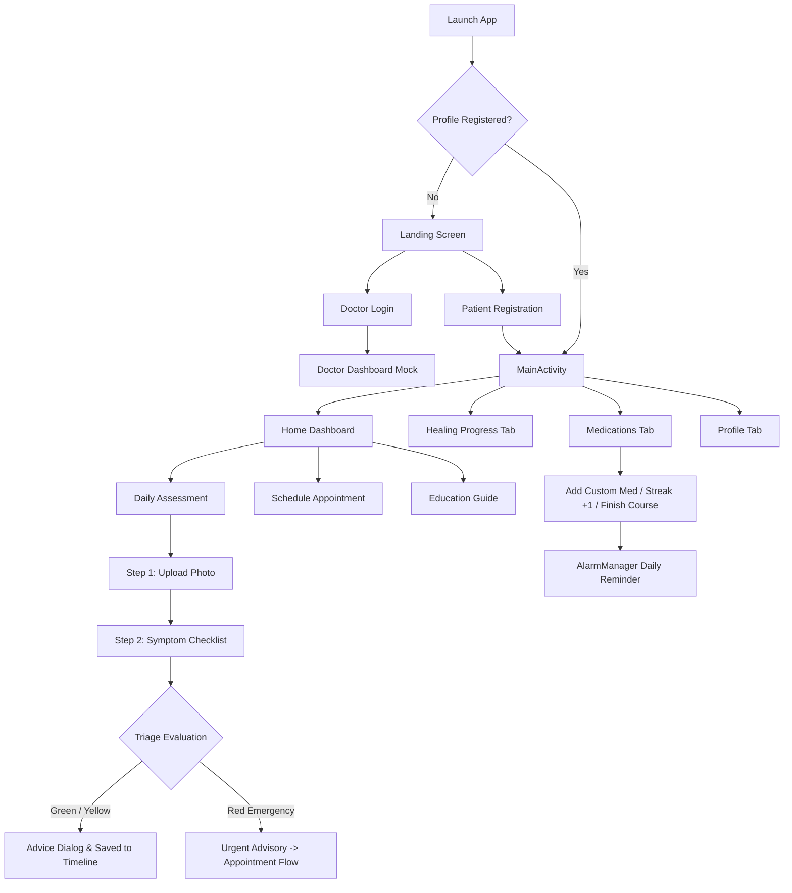

# SurgiCare 🩺

> **Intelligent Post-Operative Recovery & Wound Monitoring Companion for Android**

[](https://developer.android.com/)
[](https://kotlinlang.org/)
[-blue?style=flat)](https://developer.android.com/about/dashboards)
[-blue?style=flat)](https://developer.android.com/about/versions/14)
[](#software-architecture)
[](#license)

---

## 📖 Overview

**SurgiCare** is a native Android healthcare application crafted to assist patients during the critical transition from hospital discharge to full outpatient recovery. Designed primarily for patients recovering from minimally invasive and laparoscopic surgeries (such as appendectomy, cholecystectomy, hernia repair, and robotic procedures), SurgiCare provides structured daily check-ins, algorithmic symptom triage, medication adherence tracking, chronological healing logs, and streamlined appointment scheduling.

By empowering patients to track visual wound progress, identify early red-flag complications, and stay consistent with prescribed medication regimens, SurgiCare minimizes the risk of post-surgical readmission and facilitates peace of mind throughout rehabilitation.

---

## ✨ Key Features

### 1. 📋 Guided Patient Onboarding & Profile Management
* **Surgical Details Capture:** Collects vital clinical data including patient demographics, specific surgical procedure, procedure date, treating hospital, and known medical history.
* **Procedures Supported:** Preloaded with laparoscopic, robotic-assisted, endoscopic, and minimally invasive general surgery classifications.
* **Profile Overview:** View recovery status, personal information, and session controls directly from the profile hub.

### 2. 🔍 Two-Step Daily Assessment & Triage Engine
* **Step 1: Visual Wound Capture:** Upload photo evidence of incisions directly from device storage with an integrated cooldown rule (one submission per calendar day) to encourage routine daily monitoring.
* **Step 2: Multi-Symptom Checklist:** Select present symptoms (abdominal pain, nausea, bloating, fever, loss of appetite, constipation, difficulty passing gas) and pain severity.
* **Intelligent Triage (`SymptomCalculator`):** Categorizes recovery state using a weighted clinical rule engine:
  * 🟢 **GREEN (Normal Recovery):** Score < 3.0 — Patient receives reassurance and hygiene guidance (keep incision clean, light mobility).
  * 🟡 **YELLOW (Precautionary Warning):** Score 3.0 – 9.9 — Alerts patient to monitor symptoms and contact healthcare providers.
  * 🔴 **RED (Emergency / High Risk):** Score ≥ 10.0 (triggered by high-risk indicators like fever) — Urgently advises immediate clinical attention and initiates fast-track appointment booking.

### 3. 💊 Medication Adherence Tracker & Reminders
* **Prescription Schedule:** Pre-configured with essential post-operative medications (e.g., Amoxicillin, Ibuprofen) and supports custom additions with custom dosages.
* **Streak Gamification:** Daily "Mark as Taken" action rewards patients with adherence streaks (`🔥`), locking daily records to prevent double-dosing.
* **Smart Alarms & Notifications:** Integrates with Android's `AlarmManager` and `NotificationManager` via `MedicationReminderReceiver` to trigger exact daily reminders even across device idle states (`SCHEDULE_EXACT_ALARM`).
* **Course Completion:** Celebrate and graduate completed antibiotic or analgesic courses with the "Finish Course" feature.

### 4. 📈 Chronological Healing Timeline
* **Day-by-Day Journey:** Dynamic timeline automatically calculating elapsed recovery days (`Day 1`, `Day 2`, etc.) relative to the surgery date.
* **Visual Record Cards:** Review historical triage color badges (Green/Yellow/Red), associated symptoms, and historical wound photos side-by-side to track tissue healing.

### 5. 📅 Appointment Scheduling & Telehealth
* **Flexible Care Formats:** Schedule either virtual **Teleconsultation** or in-person **Clinic Visits**.
* **Specialist Matching:** Select from surgical specialists (General Surgery, Abdominal Specialist, Gastroenterology).
* **Booking Window:** Quick slots for "Today", "Tomorrow", or custom calendar selections with local booking confirmation.

### 6. 📚 Post-Operative Education Hub
* Comprehensive, easy-to-digest patient guides covering:
  * **Wound Care:** Cleaning incisions, dressing changes, and infection prevention.
  * **Physical Activity:** Safe mobility, lifting restrictions (< 10 lbs), and circulation support.
  * **Red Flags:** Clear thresholds for when to urgently contact the surgical team.

### 7. 👨‍⚕️ Provider / Doctor Portal (Mock)
* Dedicated login flow for clinical staff to view a summary roster of recovering patients and their real-time wound triage statuses.

---

## 🏛 Software Architecture

SurgiCare is built following the **Model-View-Presenter (MVP)** pattern combined with the **Repository Pattern** for predictable state management, clear separation of concerns, and clean testing boundaries.

```
┌────────────────────────────────────────────────────────┐
│                   View Layer (UI)                      │
│   • Activities (Landing, MainActivity, Login, etc.)    │
│   • Fragments (Dashboard, SymptomCheck, Meds, etc.)    │
└───────────────────────────▲────────────────────────────┘
                            │  Contract Interfaces
                            ▼
┌────────────────────────────────────────────────────────┐
│                   Presenter Layer                      │
│   • AssessmentPresenter       • MedsPresenter          │
│   • DashboardPresenter        • ProfilePresenter       │
│   • RegisterPresenter         • LandingPresenter       │
└───────────────────────────▲────────────────────────────┘
                            │  Business Logic & Events
                            ▼
┌────────────────────────────────────────────────────────┐
│                  Repository Layer                      │
│                  PatientRepository                     │
└───────────────▲────────────────────────▲───────────────┘
                │                        │
                ▼                        ▼
┌──────────────────────────────┐  ┌──────────────────────┐
│       AppPreferenceManager   │  │   SymptomCalculator  │
│  • SharedPreferences         │  │   • Clinical triage  │
│  • Gson Serialization        │  │     rules & scoring  │
└──────────────────────────────┘  └──────────────────────┘
```

* **Contract-Driven:** Every screen defines an explicit interface pair (`Contract.View` and `Contract.Presenter`), decoupling view components from business rules.
* **Offline-First Persistence:** `PatientRepository` manages local storage via `AppPreferenceManager` using `SharedPreferences` and Google `Gson` for fast, lightweight JSON serialization without requiring external cloud databases.
* **System Services Integration:** Background alarms and broadcast listeners communicate asynchronously with the Android OS to handle exact time-triggered reminders.

---

## 📁 Project Structure

```text
SurgiCare/
├── app/
│   ├── build.gradle.kts           # App-level build configurations & dependencies
│   ├── proguard-rules.pro         # Proguard rules for release optimization
│   └── src/
│       └── main/
│           ├── AndroidManifest.xml # App manifest, permissions, & activity declarations
│           ├── java/com/example/surgicare/
│           │   ├── MainActivity.kt               # Main shell holding bottom navigation & fragments
│           │   ├── data/
│           │   │   ├── local/
│           │   │   │   └── AppPreferenceManager.kt# SharedPreferences wrapper with Gson
│           │   │   ├── model/
│           │   │   │   ├── AssessmentEntity.kt   # Local assessment data models
│           │   │   │   ├── CheckupResult.kt      # Triage score, status color, & recommendations
│           │   │   │   └── PatientEntity.kt      # Persistent patient entity
│           │   │   └── repository/
│           │   │       └── PatientRepository.kt  # Centralized repository abstraction
│           │   ├── models/
│           │   │   ├── Appointment.kt            # Consultation booking entity
│           │   │   ├── DailyAssessment.kt        # Daily check-in form data
│           │   │   ├── Medications.kt            # Medication data structures
│           │   │   ├── Patient.kt                # Patient profile model
│           │   │   ├── ProgressRecord.kt         # Timeline card presentation model
│           │   │   └── Role.kt                   # User role enum (Patient / Doctor)
│           │   ├── screens/
│           │   │   ├── appointment/              # Appointment scheduling (teleconsult / clinic)
│           │   │   ├── assessment/               # Two-step assessment: photo upload & symptom check
│           │   │   ├── dashboard/                # Main home dashboard with summary widgets
│           │   │   ├── doctor/                   # Doctor login & dashboard portal
│           │   │   ├── education/                # Post-op recovery guide & education
│           │   │   ├── landing/                  # Landing page & patient login
│           │   │   ├── medications/              # Med tracker, reminders, & notification receiver
│           │   │   ├── profile/                  # Patient profile management & logout
│           │   │   ├── progress/                 # Chronological healing timeline & history
│           │   │   └── registration/             # Comprehensive patient onboarding flow
│           │   └── util/
│           │       ├── Constants.kt              # Static procedure choices & constants
│           │       └── SymptomCalculator.kt      # Clinical triage rule engine
│           └── res/
│               ├── drawable/                     # Shape drawables, badges, custom backgrounds
│               ├── layout/                       # Screen & item card XML layouts
│               ├── menu/                         # Bottom navigation menu definitions
│               └── values/                       # Colors, themes, and string resources
├── gradle/
│   ├── wrapper/                                  # Gradle wrapper binaries & configuration
│   └── libs.versions.toml                        # Version catalog (dependencies & plugins)
├── build.gradle.kts                              # Root build script
├── settings.gradle.kts                           # Module inclusion & repository management
└── README.md                                     # Project documentation
```

---

## 🛠 Tech Stack & Tools

| Component | Technology | Version |
|---|---|---|
| **Language** | [Kotlin](https://kotlinlang.org/) | `1.9.0` |
| **Build System** | [Gradle](https://gradle.org/) / AGP | `8.3.2` |
| **Minimum SDK** | Android 7.0 (API 24) | API 24 |
| **Target SDK** | Android 14 (API 34) | API 34 |
| **Architecture** | Model-View-Presenter (MVP) | Native |
| **UI Design** | [Google Material Components 3](https://github.com/material-components/material-components-android) | `1.11.0` |
| **Layouts** | ConstraintLayout & CoordinatorLayout | `2.1.4` |
| **Data Parsing** | [Google Gson](https://github.com/google/gson) | `2.10.1` |
| **Testing** | JUnit 4, AndroidX Test, Espresso | `4.13.2` / `3.5.1` |

---

## 📱 Permissions Used

The application declares the following permissions in [`AndroidManifest.xml`](app/src/main/AndroidManifest.xml):

* `android.permission.CAMERA` & `android.permission.READ_EXTERNAL_STORAGE` — Enables patients to document and upload wound progress photos from the device camera or photo library.
* `android.permission.POST_NOTIFICATIONS` — Dispatches medication reminder alerts to user notifications on Android 13+ (API level 33+).
* `android.permission.SCHEDULE_EXACT_ALARM` — Guarantees punctuality of exact daily medication reminder schedules.
* `android.permission.WAKE_LOCK` — Ensures the device processes scheduled reminder broadcasts reliably.

---

## 🚀 Getting Started

### Prerequisites

* **Android Studio:** Iguana (2023.2.1), Jellyfish, Koala, or newer.
* **JDK:** Java Development Kit version 17 or higher.
* **Android SDK:** Installed Android SDK Platform 34.
* **Device / Emulator:** An Android Virtual Device (AVD) or physical hardware running Android 7.0 (API 24) or higher.

### Installation & Setup

1. **Clone the repository:**
   ```bash
   git clone https://github.com/joelconstantineabaincia/NursingApp.git
   cd NursingApp
   ```

2. **Open the project in Android Studio:**
   * Launch Android Studio.
   * Select **File** > **Open...** and select the `SurgiCare` project directory.
   * Allow Gradle to sync dependencies and build the index.

3. **Build the application:**
   Using the terminal or Gradle tab:
   ```bash
   # On Windows PowerShell / Command Prompt
   .\gradlew.bat assembleDebug

   # On macOS / Linux
   ./gradlew assembleDebug
   ```

4. **Run on Emulator or Device:**
   * Connect your physical Android phone with **USB Debugging** enabled, or start an AVD emulator from Device Manager.
   * Click the **Run** button (`Shift + F10`) in Android Studio.

---

## 🧭 Application Walkthrough



---

## 🧪 Testing

Execute automated unit tests and instrumented tests via Gradle:

```bash
# Run unit tests
.\gradlew.bat test

# Run connected Android instrumented tests (requires connected device/emulator)
.\gradlew.bat connectedAndroidTest
```

---

## 👥 Contributors

* **Joel Constantine Abaincia** — *Lead Developer & Project Author* ([@joelconstantineabaincia](https://github.com/joelconstantineabaincia))
* Academic Coursework / Capstone Project — Year 2

---

## 📄 License

This project is developed as an academic software engineering project for healthcare and educational demonstration purposes. All rights reserved.

